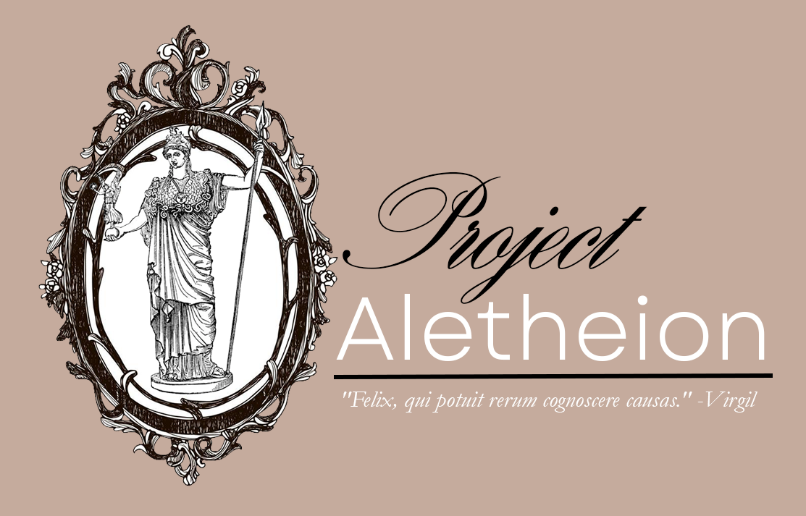
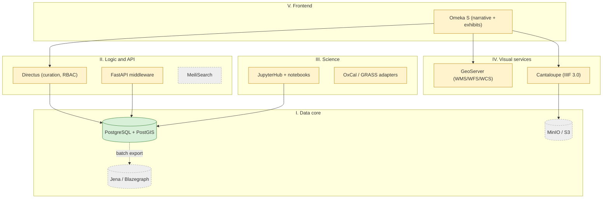

<div align="center">

# PROJECT ALETHEION · PLEROMA

### The Spatiotemporal Engine for Total History

*"Felix, qui potuit rerum cognoscere causas."* — Virgil, *Georgics* II




**An open-source Digital Humanities infrastructure for modeling the totality of human material culture, intangible heritage, biological record, and physical geography, with uncertainty treated as data.**

[Vision](#1-vision) · [Project status](#2-project-status-read-this-first) · [Architecture](#3-architecture) · [Repository map](#4-repository-map) · [Quick start](#5-quick-start) · [Data model](#6-data-model) · [Rules](#7-the-immutable-do-not-protocol) · [Roadmap](#11-roadmap) · [Contributing](#12-governance-and-contributing)

</div>

---

> **Honest status note.** `Pleroma_Guidelines_v1.0.pdf` is the authoritative *specification*. This repository is the *implementation in progress*. The PDF labels the project "Beta", but this repository today contains a database schema, an ontology profile, tested service libraries, scientific-analysis modules, governance tooling, and a **static demo frontend that uses fictional data**. It does **not** yet contain a running API server, container orchestration, a deployed Omeka S site, or any real archaeological records. Section [2](#2-project-status-read-this-first) separates what exists from what is only planned, and it was checked against the code (commit `6f43816`, reviewed 2026-11-15).

---

## Table of contents

1. [Vision](#1-vision)
2. [Project status (read this first)](#2-project-status-read-this-first)
3. [Architecture](#3-architecture)
4. [Repository map](#4-repository-map)
5. [Quick start](#5-quick-start)
6. [Data model](#6-data-model)
7. [The immutable "DO NOT" protocol](#7-the-immutable-do-not-protocol)
8. [Components in detail](#8-components-in-detail)
9. [Standards and ontologies](#9-standards-and-ontologies)
10. [Known gaps and discrepancies](#10-known-gaps-and-discrepancies)
11. [Roadmap](#11-roadmap)
12. [Governance and contributing](#12-governance-and-contributing)
13. [Licensing](#13-licensing)

---

## 1. Vision

**Project Aletheion** is an umbrella initiative for a federation of purpose-built, domain-specific research databases that interoperate through shared ontologies and linked-data protocols. The name comes from the Greek *aletheia*, truth as unconcealment: a commitment to transparency about evidence, interpretation, and uncertainty.

**Pleroma** (Greek πλήρωμα, "fullness" or "totality") is the foundational database in that federation. Its mandate is to ingest, model, relate, and analyze human prehistory and history **through approximately 500 CE**. Later textual tradition is reserved for a planned sibling *Literature Database*, which will be federated with Pleroma over SPARQL 1.1. The scope is deliberately maximalist: no civilization, period, or category of evidence is excluded a priori. Pleroma aims to be, at once:

- an archaeological database,
- a civilizational atlas,
- a bio-archaeological research platform,
- a sensory and immersive reconstruction environment, and
- a citizen-science community hub.

### Core commitments

These are described in the guidelines as constitutive: a feature that violates them is to be redesigned, not granted an exception.

| Commitment | What it means in practice |
|---|---|
| **Uncertainty is first-class data** | Dates are EDTF, never free text. Assertions carry certainty scores. Interpretation is kept separate from physical evidence, and the system must not present an interpretation as established fact. |
| **Standards over convenience** | Every entity must map to CIDOC CRM (ISO 21127) and its extensions; controlled terms use SKOS, Getty AAT, GBIF, Glottolog, and ATU/Thompson. |
| **Decoupled architecture** | Canonical data in PostgreSQL/PostGIS; semantic graph in a triple store; compute in notebooks; publishing frontend (Omeka S) consuming APIs. Omeka S is never the source of truth. |
| **Provenance, repatriation, legal integrity** | Every object and sample has a custody chain. Anything not `clear` in legal status is blocked from public export without an authorized override. |
| **Reproducibility** | Analyses are versioned notebooks whose inputs and parameters are stored with their outputs. |

---

## 2. Project status (read this first)

### What exists in this repository

| Area | State | How this was checked |
|---|---|---|
| **PostgreSQL schema** (15 SQL modules, about 107 `CREATE TABLE` statements) | Written. **6 of 15 modules applied cleanly** on a bare PostgreSQL 16 server. The other 9 need PostGIS 3.x (or tables from `site_hierarchy`) and were **not applied** in the review environment. | Applied each file with `psql -v ON_ERROR_STOP=1` |
| **Ontology profile** (`pleroma.ttl`, `vocabularies.ttl`) | Draft v0.1.0. 45 classes, 10 SKOS schemes, 24 seeded concepts. Mappings are `proposed`, not verified against pinned CRM releases. | Read; counted. The Turtle validator needs Raptor's `rapper`, which was unavailable, so **parsing was not run** |
| **Middleware libraries** (`3. middleware_api`) | Five dependency-light Python packages with unit tests. **Libraries, not a server.** | 46 tests pass |
| **Science modules** (`4. science_modules`) | Python packages, 5 notebook templates, 2 R scripts. Input-driven; **no sample data is bundled**. | 26 Python tests pass; R tests **not run** (R not installed) |
| **Visual services** (`5. visual_services`) | IIIF manifest builder, pyramid pipeline, GLB inspector, SLD generator, Cantaloupe/GeoServer config *templates*. | 21 of 23 tests pass; 2 need the `vips` CLI, which was not installed |
| **Governance tooling** (`1. project_governance`) | CLI preflight checks for writes and exports; roadmap and standards trackers. | Executed; behaved as documented |
| **Directus governance hook** | Audit logging, justification and publish gating for custom collections. | 4 Node tests pass |
| **Frontend** (`6. frontend_omeka`) | An Omeka S `layout.phtml` plus 8 static HTML pages driven by **fictional demo data**. | JS syntax-checked; asset references audited |

### What is specified but not yet in the repository

| Specified in the guidelines | Present? |
|---|---|
| FastAPI application root (the validators are libraries waiting to be mounted) | No |
| Docker Compose / Kubernetes / Helm / Prometheus / Grafana (`/infrastructure`) | No |
| CI/CD pipeline | No |
| JupyterHub deployment and `/jupyter_lab` directory | No |
| Notebook templates `stratigraphy_builder`, `oxcal_integration`, `lcp_calculator` | No (5 of the 8 templates in §6.2 exist) |
| Directus collections/configuration beyond the governance hook | No |
| MeiliSearch indexing, Zotero synchronization job, Apache Jena sync | No |
| Real OxCal, GRASS GIS, GeoServer, Cantaloupe, MinIO integration | Adapters and config templates only |
| Trust Score computation service | No (only a client-side demo calculation over fictional fixtures in the frontend) |
| Deep Map 4D, Civilization Dashboard, Agora, Computational Lab launcher, sensory/VR modules | No (the Deep Map is a placeholder panel) |
| `/data_ingest`, `/documentation`, top-level `/tests` directories | No |

The progress manifests (`roadmap.json`, `standards.json`) intentionally mark every item `not_assessed`. Nothing there is claimed as complete.

---

## 3. Architecture

The guidelines specify a five-tier decoupled architecture. The **Present?** column reflects this repository, not the specification.



*Green: schema present. Amber: libraries, adapters, config templates, or demo code present, but no running service. Grey dashed: not in the repository.*

| Tier | Component | Technology (spec) | Present in this repo? |
|---|---|---|---|
| I. Data core | RDBMS | PostgreSQL 16+ | Schema (15 modules) |
| I. Data core | Spatial | PostGIS 3.x | Used directly by 6 of 15 modules (3 more depend on those) |
| I. Data core | Triple store | Apache Jena / Blazegraph | Ontology files only |
| I. Data core | Object store | MinIO / S3 | Referenced via URI contracts; no deployment |
| II. Logic & API | Middleware | Python (FastAPI) | Validation and transformation **libraries**; no app |
| II. Logic & API | Headless CMS | Directus | Governance hook only |
| II. Logic & API | Search | MeiliSearch | No |
| III. Science | Radiocarbon | OxCal | Safe adapter boundary; no OxCal bundled |
| III. Science | Compute | JupyterHub (K8s) | Notebook templates only |
| IV. Visual | Map server | GeoServer | ImageMosaic templates + SLD generator |
| IV. Visual | Image server | Cantaloupe (IIIF 3.0) | Config example + manifest/pyramid code |
| V. Frontend | Publishing | Omeka S | `layout.phtml` + static demo pages |
| V. Frontend | Federation | SPARQL 1.1 | Federated query engine library |

### Development phases (per the guidelines)

| Phase | Platform | Objective |
|---|---|---|
| **Alpha** | Local Docker | Schema design, ontology mapping, validation, backend stack |
| **Beta** | Hosted Omeka S | Public interface testing, API consumption, 100+ records across at least 5 site hierarchies |
| **Release v1.0** | Dedicated domain | Production deployment, SPARQL federation, citizen-science activation |

---

## 4. Repository map

Top-level folders are numbered, which differs from the unnumbered tree in §11 of the guidelines. Paths contain spaces, so quote them in shell commands.

```
Project-Aletheion/
├── Pleroma_Guidelines_v1.0.pdf            Authoritative specification (41 pages)
├── 1. project_governance/
│   ├── immutable_protocols/               validate_write.py, check_public_export.py
│   ├── roadmap_phases/                    roadmap.json + validate_roadmap.py
│   └── standards_compliance/              standards.json + validate_standards.py
├── 2. backend_core/
│   ├── postgres_schema/                   15 domain modules, one 001_*.sql each (+ README)
│   ├── ontologies/                        pleroma.ttl, vocabularies.ttl, validate_ontologies.py
│   └── directus_extensions/
│       └── pleroma-governance-hook/       Directus hook: audit log, justification, publish gate
├── 3. middleware_api/                     chronology · validation · spatial · federation · transformation
├── 4. science_modules/                    archaeometry · demographic_modeling · genomics · isotopes · socio_economic
├── 5. visual_services/                    image_server · map_server · 3d_visualization
└── 6. frontend_omeka/
    └── website/
        ├── layout/                        layout.phtml (Omeka S) + 8 static HTML pages
        └── asset/                         css/, js/, img/ (≈263 MB of images)
```

Almost every module directory has its own `README.md` describing scope, limits, and the command to run its tests. The exception is the frontend, whose only README documents the generic JavaScript utilities (`6. frontend_omeka/website/asset/js/README.md`).

---

## 5. Quick start

There is no single install step yet. Each component is independently runnable. Commands below were run during the review unless noted.

**Requirements:** Python 3.10+ (the code uses `dataclass(slots=…)`; reviewed on 3.13) with **no third-party packages** for the middleware and science modules. Optional extras: Pillow and the libvips CLI (`vips`) for the image pipeline, `pyproj` (imported lazily) for coordinate systems beyond the built-in transforms, base R for the isotope scripts, Node for the Directus hook tests (reviewed on Node 22), and PostgreSQL 13+ with PostGIS 3.x for the full schema.

### Run the Python test suites

```sh
# Middleware (run from this directory)
cd "3. middleware_api"
for m in chronology validation spatial federation transformation; do
  python3 -m unittest discover -s "$m/tests" -t . -v
done

# Science modules
cd "../4. science_modules"
for m in archaeometry demographic_modeling genomics socio_economic; do
  python3 -m unittest discover -s "$m/tests" -t . -v
done
Rscript isotopes/tests/test_isotopes.R        # requires R; not run in review

# Visual services (run inside each module directory)
cd "../5. visual_services"
for m in 3d_visualization image_server map_server; do
  (cd "$m" && python3 -m unittest discover -s tests -v)
done
```

Reviewed result: **46 middleware, 26 science, 21 of 23 visual-service tests pass.** The two failures are `ImagePipelineTests` that require the `vips` CLI and fail only when it is absent.

### Run the Directus hook tests

```sh
cd "2. backend_core/directus_extensions/pleroma-governance-hook"
npm test        # node --test; 4 tests
```

### Apply the database schema

Create a database with PostGIS available, then apply modules in an order that satisfies each module's documented prerequisites. `universal_entities` goes **last** because it adds foreign keys across all other modules.

```sh
cd "2. backend_core/postgres_schema"
for m in chronometric cidoc_crm_extensions conservation_ethics hard_sciences \
         intangible_heritage 4d_gis civilization_layer historiographical \
         linguistic_sphere site_hierarchy socio_cultural source_critical \
         temporal_uncertainty theological universal_entities; do
  psql -v ON_ERROR_STOP=1 -d pleroma -f "$m"/001_*.sql || break
done
```

> **Verification caveat.** On a bare PostgreSQL 16 server (no PostGIS), `chronometric`, `cidoc_crm_extensions`, `conservation_ethics`, `hard_sciences`, `intangible_heritage`, and `temporal_uncertainty` applied without error. The remaining nine either `CREATE EXTENSION postgis` or reference tables created by `site_hierarchy`, so **their end-to-end application has not been confirmed**. Please run the loop above against a PostGIS-enabled server and report failures.
>
> Note also that `universal_entities` installs triggers requiring each parent row's media gallery to be `ready` (a gallery with at least one asset) *before* the parent row is created; it will fail when backfilling an existing database that lacks matching galleries.

### Try the governance checks

```sh
cd "1. project_governance"

# Validate a proposed write (exit 0 = valid, 1 = protocol violation, 2 = malformed JSON)
python3 immutable_protocols/validate_write.py write.json

# Block a public export if any Legal_Status is not "clear"
python3 immutable_protocols/check_public_export.py export.json

# Roadmap and standards trackers
python3 roadmap_phases/validate_roadmap.py --validate
python3 roadmap_phases/validate_roadmap.py --gate beta
python3 standards_compliance/validate_standards.py
```

Example of the write validator rejecting free-text dates (Rule 3):

```json
{ "record": { "record_type": "Find", "date": "circa 1200 BC" }, "audit": { "actor_uuid": "550e8400-e29b-41d4-a716-446655440000", "timestamp": "2026-11-14T01:00:00+04:00", "operation_type": "create", "previous_state": null, "justification": "x" } }
```

```json
{ "valid": false, "errors": ["$.date must contain a supported EDTF expression"] }
```

### Validate the ontologies

```sh
cd "2. backend_core/ontologies"
python3 validate_ontologies.py     # requires Raptor's `rapper` on PATH
```

### Browse the demo frontend

The pages are static and use relative paths. Serve the `website` folder and open a page under `/layout/`:

```sh
cd "6. frontend_omeka/website"
python3 -m http.server 8000
# then open http://localhost:8000/layout/alt_home.html
```

The demo data is **fictional** (for example "Saltglass Reach" in a "Fictional North Coast"). It exists to exercise the interface and must not be mistaken for research data. Pages load Font Awesome, Google Fonts, and GSAP from CDNs, so an internet connection is needed for full styling and animation. Rendering was not visually verified in a browser during this review.

---

## 6. Data model

The relational schema lives in `2. backend_core/postgres_schema/`. The 15 modules below correspond one-to-one with the schema folders in the guidelines' directory tree. (The guidelines also refer to "22 data modules" without enumerating them; the 15 SQL modules here group those entities by domain.)

| Module | Tables | Purpose |
|---|---:|---|
| `cidoc_crm_extensions` | 4 | Registry of external ontology releases and Pleroma-to-CRM class/property mappings. Seeded mappings are `proposed`/`unverified`. |
| `site_hierarchy` | 11 | `site`, `occupational_period`, `stratigraphic_unit`, `find`, `feature`; Harris-Matrix relationships; per-site entity-count view. |
| `civilization_layer` | 11 | Civilization complexes, polity phases (WGS 84 multipolygons), historical persons, ordered rulers and capitals. |
| `4d_gis` | 4 | Temporal geographic features, resource nodes, directed movement vectors (including `LCP_computed` provenance). |
| `hard_sciences` | 11 | Bio-samples (human, flora, fauna), lab-output pointers, genomic datasets, haplogroup assignments, dispersion analyses. |
| `chronometric` | 6 | Raw uncalibrated dates (immutable), append-only calibration results, `temporal_distribution` type, chronology sets and assertions. |
| `temporal_uncertainty` | 3 | Versioned alternative date assertions with certainty scores and typed evidence. |
| `historiographical` | 14 | Chronicle Engine: regional chronicles, cluster histories, site histories, historical events. |
| `socio_cultural` | 5 | Cultural profiles, societal aspects, typed evidence links. |
| `theological` | 6 | Theological systems, religious elements with ATU/Thompson motif links. |
| `linguistic_sphere` | 4 | Glottolog-aligned language families and time-bounded linguistic zones. |
| `source_critical` | 7 | Text witnesses, witness comparisons, interpretation hypotheses and the counter-hypothesis graph. |
| `intangible_heritage` | 9 | Liturgical events (EDTF or RFC 5545 RRULE), oral traditions, sensory profiles (RT60, palettes, audio refs). |
| `conservation_ethics` | 7 | Conservation logs and alert outbox, provenance chains, export-eligibility function, excavation protocols. |
| `universal_entities` | 5 | Media galleries and assets (IIIF), versioned annotations, Zotero-backed bibliographic references. |

### Invariants enforced by the schema

These are implemented as constraints, functions, or triggers in the SQL. They were read from the migrations and their documentation; those in modules that need PostGIS were not exercised against a live database in review.

- **Stratigraphic acyclicity.** Above/below relationships are checked as a directed acyclic graph, kept within one site, with an advisory lock to serialize concurrent writes.
- **Immutable raw dates.** Uncalibrated BP values are never overwritten; recalibration appends new `calibration_result` rows.
- **Custody before samples.** A biological sample requires an existing provenance chain with at least one custody entry and a stratigraphic-unit or surface-collection context. Human samples also carry NAGPRA, consultation, and repatriation fields.
- **Export gate.** `provenance_allows_public_export` returns true only if a chain exists and every entry has `legal_status = clear`. Administrator overrides are deliberately left to the API.
- **No binary blobs.** No binary column types exist; media columns are object-storage URIs plus SHA-256 checksums.
- **Append-only history.** Calibration results, annotation versions, and the audit log reject in-place edits.
- **Publication anchoring.** Published profiles, elements, hypotheses, and histories require bibliographic citations and, where specified, anchored evidence, enforced by deferred constraint triggers so a full set can be written in one transaction.
- **Gallery-first creation.** Parent entities must reference a `ready` media gallery that identifies them.

### What the database leaves to the API

Several rules need application logic that does not exist yet as a running service: full EDTF parsing, consistency between EDTF strings and their normalized year bounds, SKOS vocabulary membership, Trust Score computation, and administrator override of the export gate. The READMEs in each schema folder list these per module.

---

## 7. The immutable "DO NOT" protocol

Section 8 of the guidelines defines ten hard rules, to be enforced at the API validation layer and reviewed at every merge. This table records **where each is enforced in the repository today**, not where the guidelines say it should be.

| # | Rule | Enforced today by | Gap |
|---|---|---|---|
| 1 | No flat stratigraphic data | `stratigraphic_unit` is a full relational entity; `validate_write.py` rejects free-text stratigraphy | API-level `NOT NULL` rejection of parent records not yet mounted |
| 2 | No local image hosting | `media_asset` requires IIIF service and manifest pointers; `validate_write.py` requires HTTPS Cantaloupe IIIF URIs; `validation/iiif.py` does the HEAD check | No ingest pipeline service |
| 3 | No hardcoded date strings | `chronology/edtf.py` parser; `validate_write.py`; EDTF columns throughout the SQL | EDTF support is a documented *subset*, not full EDTF |
| 4 | No interpretation as fact | `interpretation_hypothesis` entity; `validate_write.py` flags interpretive labels | No enforcement found for excluding interpretive terms from entity-type vocabularies |
| 5 | No proprietary raw formats | `transformation/` accepts CSV only; `validate_write.py` rejects `.doc/.docx/.xls/.xlsx` | No file-type whitelist in an ingest service |
| 6 | No binary data in PostgreSQL | No binary columns exist in the schema; checksum + URI pattern | None found in the SQL |
| 7 | No unanchored interpretations | Deferred constraint triggers require evidence and citations before publication | API validator not mounted |
| 8 | No ad-hoc vocabulary | SKOS schemes in `vocabularies.ttl`; vocabulary URIs stored as text; the CSV importer only accepts values present in its configured crosswalk | No Directus field restriction to approved terms; no general vocabulary-membership check at write time |
| 9 | No anonymous edits | `pleroma-governance-hook` requires an authenticated actor UUID and justification on create/update | Covers Directus writes only; hard deletes are blocked pending a reasoned-delete workflow |
| 10 | No unprovenanced samples | `hard_sciences` and `conservation_ethics` require a provenance chain and collection context | None found in the SQL |

The scripts in `immutable_protocols/` are local preflight checks. They are **not** a substitute for server-side validation, database permissions on the audit table, authentication, or an approved vocabulary registry.

---

## 8. Components in detail

<details>
<summary><b>Governance tooling</b> (<code>1. project_governance</code>)</summary>

| Tool | What it does |
|---|---|
| `validate_write.py` | Validates a JSON envelope (`record` + `audit`): audit fields, EDTF forms from the guidelines, modeled stratigraphy, IIIF media pointers, interpretation evidence and certainty (0–1), biological-sample context, prohibited raw-file and embedded-binary fields. Dependency-free. |
| `check_public_export.py` | Blocks any export (JSON object or array) containing a `Legal_Status` other than `clear`, including a missing or non-string value when the field is present. |
| `validate_roadmap.py` | Validates `roadmap.json`, prints completion per phase, and checks phase gates. `done` requires an `evidence` reference; `blocked` requires a `blocker`. |
| `validate_standards.py` | Validates `standards.json` (16 standards, all `not_assessed`). `compliant` requires evidence. |

</details>

<details>
<summary><b>Middleware libraries</b> (<code>3. middleware_api</code>)</summary>

These are reusable service components intended to be mounted into the FastAPI application that does not yet exist. Callers must fail a write whenever a returned `ValidationReport` contains issues.

| Package | Provides |
|---|---|
| `chronology` | EDTF parsing/normalization (signed years, `~ ? %`, ranges, open-ended, decades, centuries, sets); temporal probability-curve validation; a safe `OxCalRunner` adapter boundary (JSON on stdin, no shell, timeout, output validated); High/Low chronology-set display transforms that never mutate calibrated values. The `~` default is ±10 years. |
| `validation` | `HarrisMatrixValidator` (reference, same-site, and acyclicity checks with a deterministic topological order and cycle reporting); temporal-order and stratigraphic temporal-consistency checks; PostGIS `ST_IsValidDetail()` geometry validation; publication anchoring; `IIIFManifestValidator` (HEAD check with host allowlist, HTTPS, timeout, redirect rejection). |
| `spatial` | WGS 84 LineString validation; `GrassLCPRunner` adapter for `r.cost`/`r.walk` (enforces ≤30 m DEM, endpoint matching, reproducibility fields, emits `Movement_Vector` payloads with `LCP_computed`); `PaleoclimateCatalog` (EDTF to CHELSA-TraCE21k/PMIP4 slices); bounded WMS 1.3.0 URL builder. **No climate layers are fabricated.** |
| `federation` | Read-only SPARQL 1.1 search across Pleroma and the Literature Database, queried concurrently, joined on a shared SKOS scheme, with partial-failure reporting, host allowlists, and escaped search text. |
| `transformation` | Profile-driven CSV to CIDOC-CRM JSON-LD importer. A whole file is rejected if any row is invalid. Accepts only verified CRM mappings. **No source-specific profile ships**, and the mapping registry seeds only proposed class mappings. |

</details>

<details>
<summary><b>Science modules</b> (<code>4. science_modules</code>)</summary>

All modules are input-driven: assumptions are required parameters, not hardcoded defaults, and no module invents coefficients or interprets results on the analyst's behalf. Each produces a validated *writeback payload* (a service contract); no database or API endpoint exists yet to receive them.

| Module | Provides | Notebook / script |
|---|---|---|
| `archaeometry` | Technique-aware validation for XRF, pXRF, SEM-EDS, INAA, XRD and FTIR results; `MaterialAnalysisEvent` payload; bounded open-format spectrum reader and non-extrapolating resampler. | n/a |
| `demographic_modeling` | `SettlementPopulationModel`: an interval-based capacity estimator (area × inhabited fraction × density × persons per dwelling, bounded by carrying capacity). A scenario, not a census. | `population_estimates.ipynb` |
| `genomics` | Lab-output and dataset metadata contracts, haplogroup frequency aggregation with confidence intervals, fail-closed public-release gate, minimum-cohort-size suppression. No sequence parsing or haplogroup inference. | `haplogroup_dispersion.ipynb` |
| `isotopes` | Base-R δ¹³C/δ¹⁵N biplot with uncertainty intervals; ⁸⁷Sr/⁸⁶Sr interval comparison against sourced baselines. Reports overlap only; assigns no origin. | `carbon_nitrogen_ratios.ipynb`, `isotope_analysis.R`, `strontium_analysis.R` |
| `socio_economic` | Silver-equivalence normalization (baseline = 100) and directed trade-network metrics (degree, betweenness, shortest paths, label-propagation communities). | `economic_indicators.ipynb`, `network_analyzer.ipynb` |

</details>

<details>
<summary><b>Visual services</b> (<code>5. visual_services</code>)</summary>

| Module | Provides | Limits |
|---|---|---|
| `image_server` | Source integrity check, EXIF/XMP extraction, tiled pyramidal-TIFF derivative (needs Pillow and `vips`), IIIF Presentation 3.0 manifest builder, append-only annotation payloads, and a Cantaloupe 5.x example config for MinIO. | Does not upload to MinIO, write to PostgreSQL, or expose an HTTP API. A manifest is limited to a single rights URI. |
| `map_server` | GeoServer ImageMosaic templates for time-enabled GeoTIFFs; `sld.py` builds SLD 1.0 raster styles from dataset-supplied classes or breakpoints. | No built-in Paleo-Köppen values. Layer IDs, temporal mapping, and authorization are deployment work. |
| `3d_visualization` | Structural inspector for self-contained GLB files, a `media_asset` payload, and a viewer-config contract (HTTPS allowlist, no signed-query URLs, autoplay off). | Not full Khronos conformance; no Three.js or A-Frame viewer exists. |

</details>

<details>
<summary><b>Directus governance hook</b> (<code>2. backend_core/directus_extensions</code>)</summary>

Applies baseline write governance to custom collections: it requires an authenticated user UUID and a per-write `_pleroma_justification`; appends create/update audit events (with the full previous JSON state) inside the current transaction; gates publishing to administrators and roles listed in `PLEROMA_PUBLISHER_ROLE_IDS`; and protects the audit collection while blocking hard deletes. Apply `pleroma_audit_log.sql` first, and give the Directus database role `INSERT` but not ownership of the audit table. Declared compatibility is Directus 10/11. It is not a replacement for RBAC policy.

</details>

<details>
<summary><b>Frontend</b> (<code>6. frontend_omeka</code>)</summary>

`layout.phtml` is an Omeka S layout with a sidebar, dynamic site navigation, a "Comp. Lab" link, and a Deep Map overlay that currently displays only *"The map service is not configured in this deployment."* The folder does **not** contain a complete installable Omeka S theme (there is no `theme.ini` or theme config).

The eight static pages under `layout/` are `alt_home` (PLEROMA landing), `about_us`, `archaeology`, `history`, `linguistics`, `religion`, `science`, and `society`. The archaeology, history, and linguistics pages are driven by shared fictional fixtures (`window.PLEROMA_ARCHAEOLOGY_DEMO`, `…HISTORY_DEMO`, `…LINGUISTICS_DEMO`). The archaeology and history scripts build stratigraphy and cluster graphs and show Trust Score badges computed from fixtures. No page calls a live Pleroma API. `asset/js/README.md` documents the generic JS utility modules (animations, interactions, slideshow, helpers).

</details>

---

## 9. Standards and ontologies

| Domain | Standard | Where it appears today |
|---|---|---|
| Upper ontology | CIDOC CRM (ISO 21127) | `pleroma.ttl` subclassing; mapping registry (proposed) |
| Archaeology / science / space-time / argumentation | CRMarchaeo, CRMsci, CRMgeo, CRMinf | Prefixes and proposed mappings |
| Bibliographic | FRBRoo, Zotero + DOI | Text-witness mapping; `bibliographic_reference` table |
| Object typology | Getty AAT | Required for `Find` object types |
| Taxonomy | GBIF Backbone | GBIF taxon keys required for flora/fauna |
| Language | Glottolog | Codes format-checked; release membership unverified |
| Narrative motifs | ATU + Thompson Motif-Index | Scheme and concept URIs stored |
| Dates | EDTF (ISO 8601-2:2019) | Parser covers a documented subset |
| Geometry | OGC / ISO 19107 | PostGIS `geography(…, 4326)` with validity checks |
| Imagery | IIIF Presentation + Image 3.0 | Manifest builder; Cantaloupe config |
| Vocabularies | SKOS | `vocabularies.ttl` |
| Serialization | Turtle / JSON-LD | Ontology files; importer output |

`pleroma.ttl` is a project-owned *profile*, not a copy of any external ontology. External releases must be pinned and class IRIs verified before production publication. `vocabularies.ttl` seeds only values named in the guidelines; the object-type, material-type, event-type, and feature-type schemes deliberately contain no invented terms.

**Planned external reconciliation targets** (not yet implemented): Pleiades and Wikidata for sites; VIAF and Wikidata for persons; Getty AAT for object types; GBIF for species; Glottolog for languages; CrossRef/DOI for references.

---

## 10. Known gaps and discrepancies

Recorded here so contributors and reviewers are not surprised.

**Repository hygiene**
- No `LICENSE` file, `CONTRIBUTING.md`, `.gitignore`, dependency manifest, or CI configuration.
- Compiled `__pycache__/*.pyc` files and a vendored `node_modules/gsap` are committed.
- The working tree is large (about 282 MB, roughly 263 MB of it images). Some images are large and are not served through IIIF, which the guidelines' own Rule 2 would require for production.
- Bundled imagery has no rights or attribution manifest. The guidelines (§9.4) require rights statements for media, so image provenance should be documented or the images replaced.

**Frontend**
- `layout/linguistics.html` loads `asset/js/linguistics-page.js`, **which does not exist**, so that page's interactive logic is absent. Only the demo data and CSS are present.
- `asset/css/about_us.css` references two missing images (`G.B.Gaulli-Triumph_of_the_Name_of_Jesus.jpg`, `feast-venus-rubens.jpg`).
- `asset/js/bundle.js` and `bundle-min.js` are not referenced by any layout page. `location-modal.js` is also unreferenced.
- `layout.phtml` loads OpenLayers CSS but no OpenLayers script.
- Several pages depend on third-party CDNs (Font Awesome, Google Fonts, GSAP, OpenLayers CSS).

**Specification vs. implementation**
- The PDF's directory tree (§11) is not followed (numbered folders; no `infrastructure/`, `jupyter_lab/`, `data_ingest/`, `documentation/`, or top-level `tests/`). Tests live beside each module.
- The PDF refers to 22 data modules without listing them; the repository has 15 SQL modules matching the 15 schema folders in the PDF's tree.
- The production domain is inconsistent across sources: the PDF uses both `projectaletheion.org` and `project-aletheion.org`, and `pleroma.ttl` uses `pleroma.project-aletheion.org`. Pick one before minting persistent URIs.
- The guidelines label the project "Beta"; the repository does not meet the Beta exit criteria (100+ records across at least 5 site hierarchies, functional navigation modules).

**Scientific caveats built into the code**
- The EDTF implementation is a bounded subset, not the full standard.
- Seeded CRM mappings are unverified; `transformation` will not guess property mappings.
- Notebook templates ship without sample data by design.

---

## 11. Roadmap

The phase structure comes from §§1.4 and 12 of the guidelines and is tracked in [`roadmap.json`](./1.%20project_governance/roadmap_phases/roadmap.json). All milestones are currently `not_assessed`.

<details>
<summary><b>Alpha: Foundations</b></summary>

PostgreSQL schema for all data modules; CIDOC CRM suite as schema extensions and TTL; Docker Compose environment (PostgreSQL/PostGIS, Directus, Jena, MinIO, Cantaloupe, GeoServer, MeiliSearch, FastAPI); FastAPI validation layer (EDTF, Harris Matrix, geometry); SKOS concept schemes (Getty AAT subset, materials, events, features); Zotero library and sync job; local JupyterHub with the Stratigraphy Builder and C14 Plotter against a synthetic dataset. *Exit: all modules schema-complete, CI/CD operational.*

</details>

<details>
<summary><b>Beta: Testing on Omeka S</b></summary>

Omeka S with item types mapped to Pleroma entities; Aletheion Visualization theme (Deep Map, Civilization Dashboard stub, Climate Context sidebar); IIIF viewer and Cantaloupe integration; first corpus of at least 5 full site hierarchies at Gold trust score; cross-module navigation tests; Agora pilot; user feedback; security audit and RBAC/Legal_Status review. *Exit: 100+ records across at least 5 site hierarchies, navigation modules functional.*

</details>

<details>
<summary><b>Release v1.0: Production domain</b></summary>

Production domain; Kubernetes deployment with TLS, CDN, backups; SPARQL federation with the Literature Database; researcher JupyterHub; published API and SPARQL documentation; public data access; DOI-registered initial corpus (for example Zenodo or DARIAH); Prometheus/Grafana monitoring and incident response. *Exit: full-stack deployment, validated federation, public launch.*

</details>

<details>
<summary><b>Post-release priorities</b></summary>

Systematic ingestion of published excavation reports; battle tactical map; VR site exploration (A-Frame plus photogrammetry streaming); acoustic simulation and sensory reconstruction; the Aletheion Literature Database as a federated sibling; institutional partnerships with museums, research institutes, and heritage bodies.

</details>

### Suggested next steps given the current state

1. Add a FastAPI application root that mounts the existing validators.
2. Add `docker-compose.yml` with PostGIS so the full schema can be applied and tested in CI.
3. Add a `LICENSE` file, `.gitignore`, and a dependency manifest.
4. Fix the frontend gaps listed in [§10](#10-known-gaps-and-discrepancies).
5. Add the three missing notebook templates and a first reviewed real dataset.

---

## 12. Governance and contributing

### Roles (guidelines §9.1)

| Role | Access | Typical work |
|---|---|---|
| Principal Investigator | Full administrative | Architecture, ontology governance, domain management |
| Domain Specialist | Module-scoped write and publish | Curation and quality review in an assigned domain |
| Credentialed Contributor | Write (draft only, no publish) | Data entry, bibliography, digitization, notebook execution |
| Agora Contributor (citizen) | Crowdsourcing tasks only | Transcription, classification, identification |
| Read-only / Public API | `GET` only | Querying published data |

### Contribution standards

- Code goes through pull requests against the development branch; no direct commits to `main`.
- A PR should describe the change, flag any schema or ontology impact, pass unit and integration tests, and update documentation. New endpoints must be in the OpenAPI spec before acceptance.
- Schema migrations should be backward-compatible; breaking changes need a major version bump and a migration path.
- Python follows PEP 8; JavaScript/TypeScript follows the project's ESLint configuration.
- Narrative fields use clear academic prose, not bare bullet summaries. Non-English sources need an English working translation with the original text preserved in `Original_Language_Text`.
- Reuse existing vocabulary terms; duplicate concepts are rejected in review. New terms go through vocabulary governance, never directly into production data.
- Do not upload media you lack the rights to.

### Trust Score (specification)

Every major entity is to receive a 0.0–1.0 score, shown as a badge. This is specified but **not yet implemented as a service**.

| Component | Weight |
|---|---:|
| Completeness index | 30% |
| Bibliographic density | 25% |
| Spatial precision | 20% |
| Excavation methodology | 15% |
| Data currency | 10% |

Badges: **Gold** ≥ 0.80 · **Silver** 0.55–0.79 · **Bronze** 0.30–0.54 · **Incomplete** < 0.30.

---

## 13. Licensing

The guidelines (§9.4) specify:

- **Code:** GNU Affero General Public License v3.0 (AGPL-3.0).
- **Database content** produced by the project: Creative Commons Attribution 4.0 (CC BY 4.0), subject to legal restrictions on individual records (see `Provenance_Chain.Legal_Status`).
- **Media assets:** licensed per each asset's `Rights` field.
- Third-party standards and data (CIDOC CRM, Getty AAT, GBIF, Glottolog) are used under their own terms and are not re-licensed.

> **Note:** these licenses are the project's stated intent. No `LICENSE` file has been committed yet, so until one is added, reuse terms are not formally established in this repository.

---

<div align="center">

*Aletheia: truth as unconcealment.*

Specification: [`Pleroma_Guidelines_v1.0.pdf`](./Pleroma_Guidelines_v1.0.pdf)

</div>
